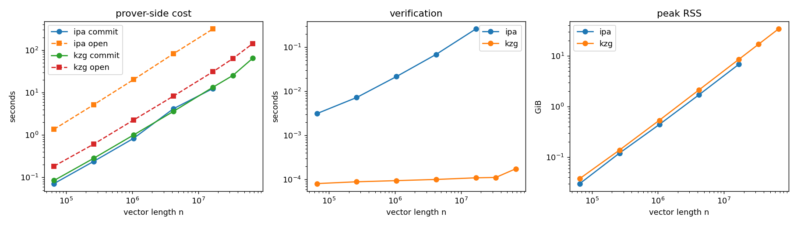
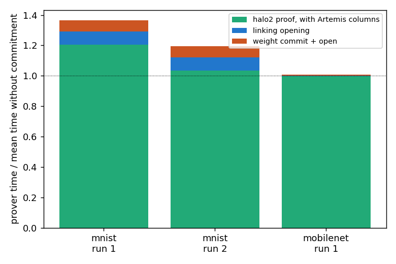
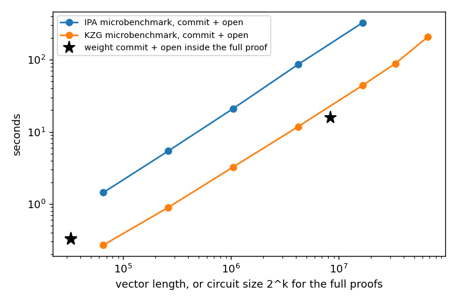
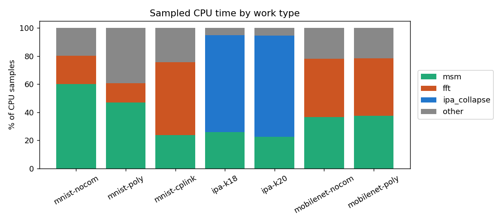
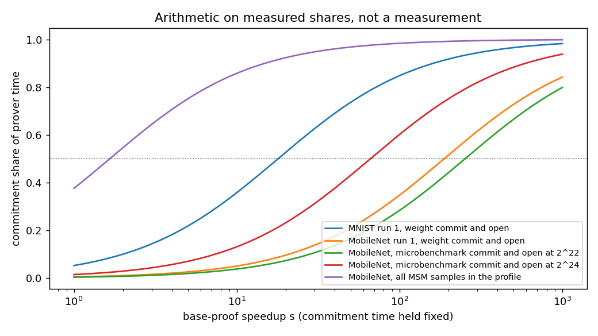

# Artemis commitment cost at larger sizes

I wanted to know whether the commitment step in Artemis stays cheap as models grow, or whether it becomes the bottleneck again once the rest of the proof gets faster. I ran the public Artemis code (pps-lab/artemis, commit 69dff50) on one Killarney node with 16 CPU threads. The node also has an L40S GPU, but the MSM code in this repo only runs on the CPU, so the GPU sat idle. Every number below comes from my own runs, and the raw logs are in results/raw.

## What I reproduced against the paper

The repo only ships weights and inputs for one small model, the 8.1K parameter MNIST network, so MNIST is the only model I was able to compare with the paper. The paper reports a prover overhead between 1.01x and 1.15x for Artemis with KZG. I measured 1.29x in my first run (4.80 s without commitments, 6.18 s with Artemis) and 1.27x in a second run (4.25 s and 5.40 s). Both are above the paper's range. The verifier is also slower, at 12.9 ms against 6.4 ms in the first run, where the paper lists 8 ms against 7 ms. I used 16 threads where the paper used a 32 vCPU AWS machine, and I took the Artemis settings (poly_cols=3, 15 rows, 10 columns) from the repo's test.zsh. I do not know whether the gap comes from the hardware, from my settings, or from something else. The Lunar-style CP-link baseline took 37.96 s and 34.43 s in the two runs, about eight times the time without commitments.

## The main scaling result

1. Committing to and opening one vector with KZG grows almost linearly with its length n. It took 0.27 s at n = 2^16 and 207 s at 2^26, and a log-log fit over seven sizes gives a slope of 0.95.
2. IPA follows the same shape at a higher cost, from 1.4 s at 2^16 to 328 s at 2^24 with a slope of 0.98. Opening is 96 percent of the 328 s at 2^24. In the IPA profiles at 2^18 and 2^20 about 70 percent of the sampled time goes to folding the generator vector in each round, which is separate from the MSM.
3. KZG verification stays between 0.08 and 0.18 ms at every size, while IPA verification grows from 3 ms to 258 ms. Peak memory is linear, from 39 MiB at 2^16 to 34 GiB for KZG at 2^26.
4. Inside the full proofs, the weight commit and open took 5 to 6 percent of the prover time for MNIST and 0.53 percent for the truncated MobileNet (15.7 s of 2981 s).
5. The measurements stop at KZG 2^26, IPA 2^24 and a MobileNet circuit of size 2^23. I did not measure anything larger and I did not extrapolate.

## Where the time goes in the full proofs

I split each Artemis-style run into three parts using the timers the program prints. The first part is the halo2 proof, which includes the extra columns Artemis adds. The second is the opening of the advice polynomial, which I call the linking opening because it ties the value inside the circuit to the committed weights. The third is the commit and open of the weight polynomial. I read this split from src/utils/proving_kzg.rs, where the timer is reset between the two "KZG proof time" lines.

For the truncated MobileNet the halo2 proof took 2948 s, the linking opening 17.3 s and the weight commit and open 15.7 s, for 2981 s in total. Without commitments the same circuit took 2880 s and 3041 s in two runs, so the two baselines differ by 5.5 percent and the Artemis-style run lands between them. At this size I see no slowdown in the halo2 proof itself. For MNIST the second run splits into 4.68 s, 0.39 s and 0.33 s. There the halo2 proof was 3 to 20 percent slower than the mean baseline, and the two baseline runs differ from each other by 12 percent, so I treat this gap as unresolved.

The 15.7 s for the MobileNet weight commit and open sits between my microbenchmark values for 2^22 (11.8 s) and 2^24 (44.4 s), which bracket the 2^23 circuit. The two experiments agree on the cost at this size. The full proofs open the padded circuit domain (2^15 for MNIST, 2^23 for MobileNet) and not the 7.5K or 557K weights themselves, which is why the stars in the chart below sit where they do.

perf is blocked on Killarney (perf_event_paranoid is 4), so I wrote a small sampler instead. It is an LD_PRELOAD library in profiler/sampler.c with one CPU-time timer per thread, and I resolve the addresses with nm afterwards. I tested it on a toy program first. In both MobileNet runs about 37 percent of the CPU samples fall inside MSM code, 41 percent inside FFTs and 22 percent elsewhere, with and without Artemis. Field multiplications account for about 65 percent of the leaf samples. For MNIST the MSM share is 60 percent without commitments and 47 percent with Artemis, and the CP-link run spends 52 percent in FFTs. These profiles cover the whole process, including parameter loading and key generation. The sampler also cannot tell the base proof's own MSMs from the weight commitment, because stacks from the rayon worker threads start at the job without its caller, so the program's own timers carry the Artemis-specific split. The KZG microbenchmark profiles are mostly parameter loading (53.6 s of loading against 23.5 s of commit and open at 2^22), so I left them out of the chart. I queued a run to subtract the loading and it had not started when I wrote this.

## Arithmetic for a faster base proof

The original question assumes the base proof gets much faster. I did not speed it up, so I did arithmetic on the shares I measured. If the commitment time stays fixed and the rest of the proof gets s times faster, a commitment share f becomes f / (f + (1 - f) / s). Solving for the speedup needed to reach a target share p gives s = (1 - f) / f * p / (1 - p). This is arithmetic and not a measurement, and it ignores any GPU or other change to the commitment code.

Taking the weight commit and open alone (0.53 percent of MobileNet), the rest of the proof must get 63 times faster for commitment to reach 25 percent of the time, 188 times for 50 percent and 1689 times for 90 percent. Adding the linking opening (1.11 percent in total) gives 30, 89 and 802. For MNIST, where the weight commit and open is 5.3 to 6.1 percent, the numbers are 5 to 6, 15 to 18 and 139 to 162. Using my microbenchmarks at 2^22 and 2^24 in place of the measured 15.7 s gives a 50 percent speedup between 66 and 252 for MobileNet.

The second reading is to count every MSM, including the ones halo2 does for its own columns. These are not Artemis overhead, but they are commitment work. In the MobileNet profile they make up 37.6 percent of the samples already, and they would reach half of the time once the rest of the proof gets 1.7 times faster. This reading matters most for the original question, but the profile it rests on includes parameter loading and key generation, so I treat 1.7 as a rough figure.

## What this does not show

1. I have only two model sizes end to end. The other bundled examples (clip, gpt-2 and twitter) ship configs and proofs without weights, so I did not run them, and I did not fit a curve through two points.
2. I never sped up the base proof. The section above is arithmetic only.
3. The microbenchmark commits and opens one random dense vector at one point. The full proofs open the padded circuit domain, so the two agree on cost at 2^23 but I did not compare them at other sizes.
4. The fitted slopes of 0.95 and 0.98 do not separate linear growth from n log n with this few sizes.
5. The sampler is rough. It unwinds stacks inside a signal handler, which is not strictly safe, and it gives CPU shares and not cycle counts.
6. I did not test GPU MSMs because the repo has none.
7. The paper comparison covers the MNIST prover and verifier only. I did not run IPA end to end, Poseidon or Apollo, and I did not compare absolute times.
8. Most configurations have a single run. The MobileNet baselines and the MNIST runs each have two.

## Things to double check

The MNIST overhead of 1.27x to 1.29x is higher than the paper's range and I have not found out why. The pinned toolchain (nightly-2024-05-09) no longer builds, because constant_time_eq 0.4.2 needs edition 2024 and the repo has no Cargo.lock, so I used the README's rustup override set nightly and the dependency versions are whatever crates.io had in November 2026.

The repo ships a stale results/output.csv with a 67.9 s MNIST row. My first no-commitment run crashed on a missing params_kzg_Bn256 directory, and I copied the old file as if it were a result. I caught it when the rerun gave 4.80 s, and I do not use the 67.9 s anywhere. The time_circuit argument for the number of runs only repeats verification, so my second MNIST run is one more prover run and not three.

The KZG 2^26 passes took 194 s and 220 s, which differ by 13 percent, and the step from 2^25 to 2^26 cost 2.3 times where earlier steps cost 2.0 times. I did not look into this. SRS setup is left out of every prover time, and it took 6286 s at 2^26.

The MobileNet runs needed more than 128 GB. They were killed at 128 GB and at 96 GB, and finished with 200 GB and 250 GB at a peak of 155 to 161 GiB. One job finished in 1 s on node kn159 with no output and I do not know why, so I reran it on another node. The only input file the repo ships for this model is examples/train_graph/input.msgpack, and I paired it with the truncated model because the model file matches train.msgpack byte for byte. The rows and columns (23 and 20) come from test.zsh.

## Changes to the Artemis repo and files

I changed no existing file in the Artemis repo. I added src/bin/commit_microbench.rs (a copy is in rust/), which calls the repo's own ParamsKZG, ParamsIPA, prover and verifier code. Everything else lives in this folder, with job scripts in slurm/, the sampler in profiler/, the analysis in scripts/ and the data and plots in results/. To redo the analysis, run e2e_summary.py, analyze.py, profile_report.py, breakeven.py and fraction_plot.py from scripts/ in this order.

## Summary for the email

I timed the commitment and opening step from the Artemis code on its own for vectors up to 67 million elements with KZG and 16 million with IPA, and the cost grows close to linearly with size while KZG verification stays near 0.1 ms. Inside the full proofs, committing to and opening the weights took 5 to 6 percent of the prover time on MNIST and about 0.5 percent on a truncated MobileNet with a 557K element weight tensor, although my MNIST overhead of 1.27x to 1.29x is above the paper's 1.01x to 1.15x. I only have two model sizes end to end, so I do not know what happens beyond them, and I am happy to share the scripts and raw numbers.
