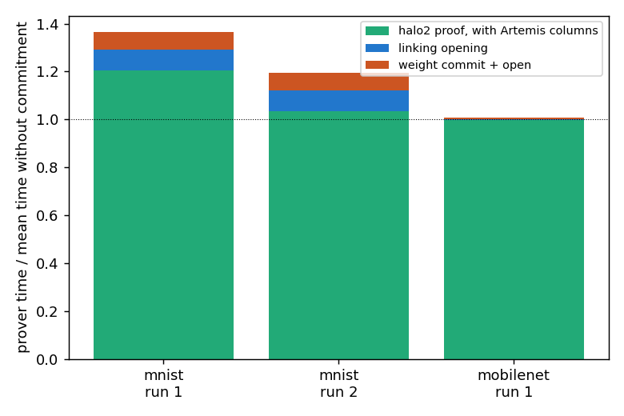
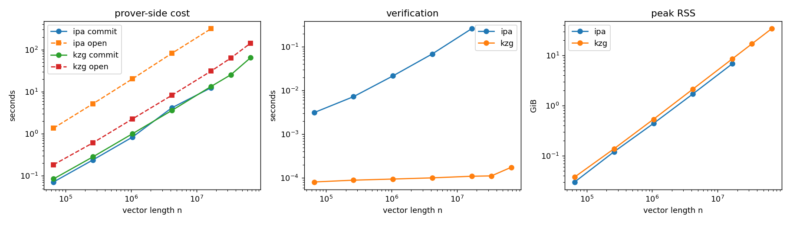
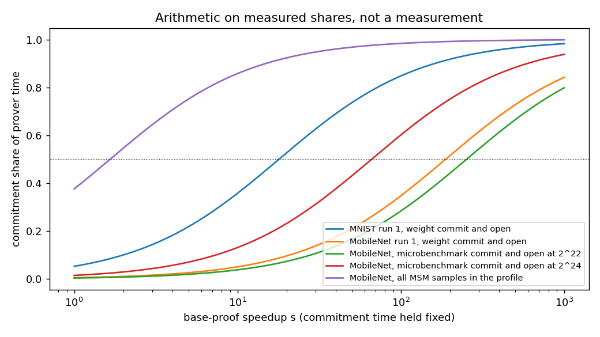

*Disclosure: I wrote general outline of this short writeup and had Claude create the first draft. ~60% of the final text below is my own.*

# Does commitment linking stay affordable as proofs get faster?

I tried to answer this with the authors' public Artemis code (halo2 with KZG or IPA commitments) on one 16-thread CPU node. I timed the commit and open step on its own for vectors up to 67 million entries, and I ran full proofs of the two bundled models with weights, an 8.1K-parameter MNIST network and a truncated MobileNet. Each section below takes one claim from the question and gives my verdict.

## Artemis allows low cost commitment checks

Short answer, yes at MobileNet scale and only roughly on MNIST. On the truncated MobileNet, committing to and opening the weights plus the linking opening took 33 s of a 2981 s proof, about 1.1 percent. The same proof without commitments took 2880 s and 3041 s in two runs, so the difference sits inside the run-to-run noise. On MNIST the Artemis-style proof took 1.27x to 1.29x the no-commitment time, above the paper's 1.01x to 1.15x, and I do not know why. The weight commit and linking were about 13 percent of that run.

## Artemis works with sum-check provers

Not tested. The repo is built on halo2, which is not a sum-check prover, so my runs say nothing about this claim.

## zkLLM proves 13 billion parameter models

Not tested either. I did not run zkLLM, and my largest vector had 67 million entries, about 200 times fewer than 13 billion. I do not know what commitment costs at that size.

## Opening proofs need an MSM linear in the input

Consistent with my measurements. KZG commit and open took 0.27 s at 65 thousand entries and 207 s at 67 million, a vector 1,024 times longer, and a log-log fit over seven sizes gives a slope of 0.95. IPA took 1.4 s and 328 s for 65 thousand and 16 million entries with a slope of 0.98, and memory grew linearly as well (34 GiB for KZG at 67 million). I do not have enough sizes to tell linear growth from n log n. About 70 percent of the samples in my IPA profile fall in the per-round folding of the public curve points, which also grows linearly with the input.

## Does linking stay affordable once the prover is fast?

Short answer, the Artemis link does, but the commitment work inside the proof system would become the bottleneck first. I did not make anything faster, so these numbers are arithmetic on the shares I measured. If the link's cost stays fixed, the rest of the MobileNet proof must get about 89 times faster before the link and weight commit reach half of the prover time (about 7 times for MNIST). The proof system also commits to its own columns, which is not Artemis overhead. Those MSMs already take 38 percent of the CPU samples in my MobileNet profile, and they reach half of the time once everything else gets 1.7 times faster. The 38 percent is a rough figure, because the profile includes parameter loading and key generation. I did not test a sum-check prover, so I do not know how much faster one makes the main proof.

## Limits

1. I have two models, and MobileNet is the only large one. Most configurations ran once or twice, and the no-commitment baselines differ by 12 percent on MNIST and 5.5 percent on MobileNet.
2. Everything ran on the CPU. The repo has no GPU commitment code, so I did not test one.
3. perf is blocked on the cluster, so the profile comes from a sampler I wrote, and it gives rough CPU shares.
4. The MNIST overhead above the paper's range is unexplained. I used 16 threads where the paper used 32.

## More detail

FINDINGS.md has the full writeup with every number and caveat, and README_ANNOTATED.md walks through it for readers without a cryptography background. The only file added to the Artemis repo is rust/commit_microbench.rs. Job scripts are in slurm/, the sampler in profiler/, the analysis in scripts/ and the data and plots in results/.
