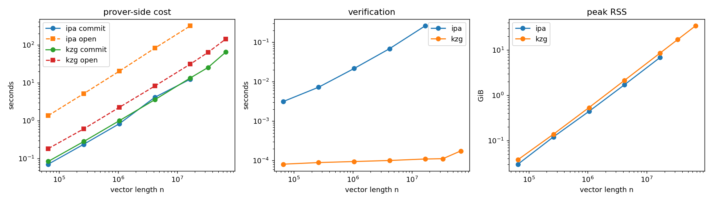
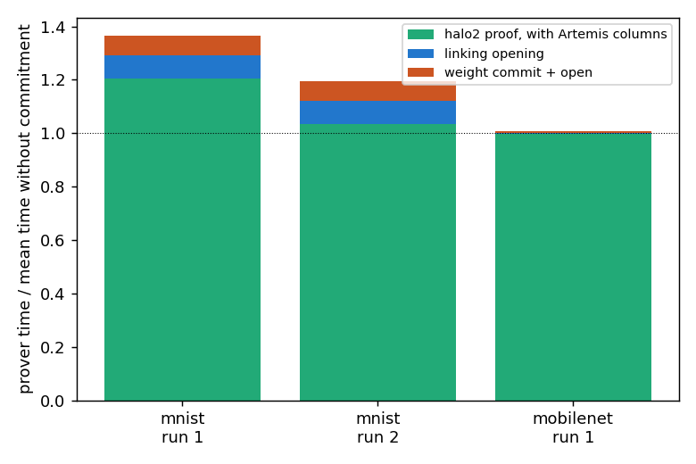
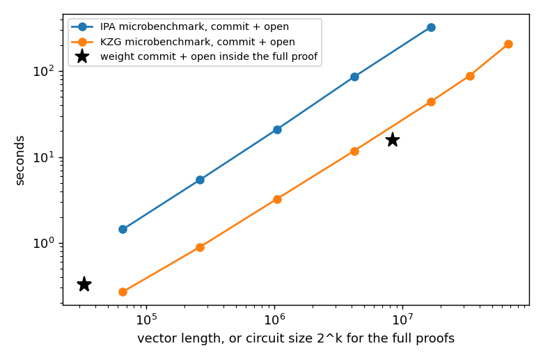
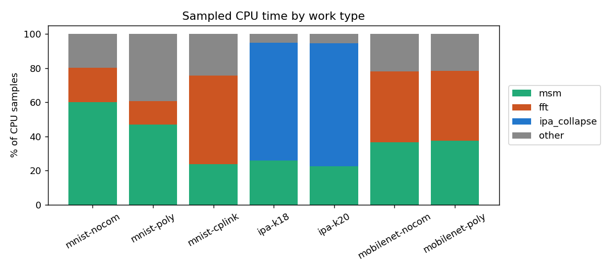
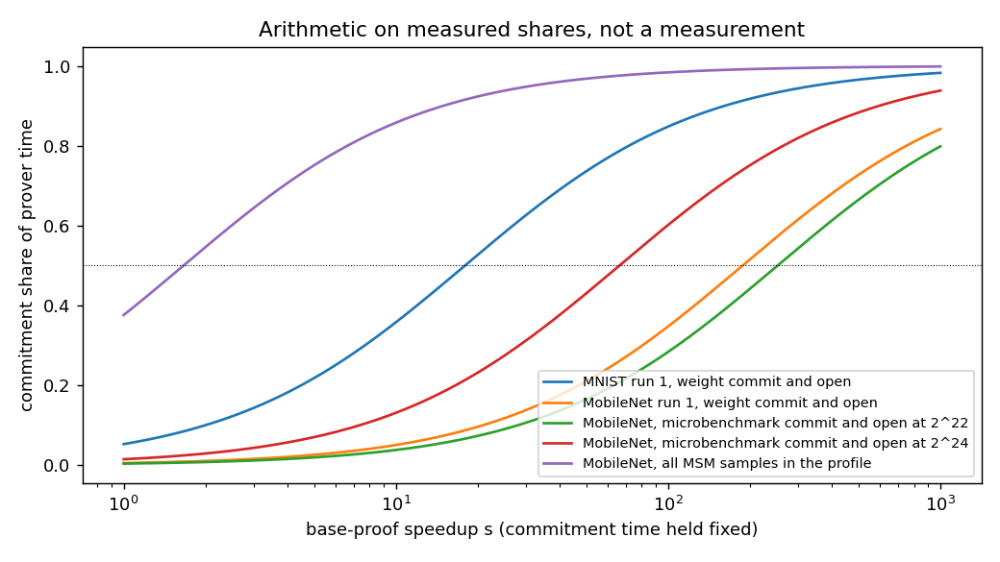

# Annotated walkthrough of the Artemis commitment-cost writeup

Plain text is the writeup exactly as it appears in README.md. Everything inside a quote block is an annotation added for readers with an ML background who have not read the Artemis paper and have not worked with cryptography or systems code. The annotations explain terms, say why each measurement was taken, and point out what to look for in each chart. Where I describe how the Artemis code works, I am going from my own reading of its source and of the paper's evaluation section, and I say so when I am less sure.

> **Primer: the setting in six paragraphs**
>
> **Zero-knowledge ML (zkML).** Suppose a company runs a model on your input and sends back a prediction. How do you know it ran the model it advertised, and not a cheaper one? In zkML the company (the prover) also sends a short proof that "this output is what model M produces on this input". You (the verifier) check the proof quickly without rerunning the model. The catch is the prover's cost. Turning a forward pass into a proof took about 50 minutes for the truncated MobileNet I ran, and the larger models in the paper take much longer. Plain inference for a network of this size takes a fraction of a second (a rough background figure, which I did not time). Everything in this writeup is about that prover cost.
>
> **Why weights get committed.** A proof about "the model" is only useful if the verifier knows which weights were used. Publishing the weights defeats the purpose, so the prover instead publishes a commitment: a short fingerprint of the weights. It is like a hash, except it is built so you can later prove facts about the committed data without revealing it. The proof then has to show two things at once, that the output is correct and that the weights used were the ones behind the commitment.
>
> **The cost question.** The straightforward way to tie the two together is expensive. The paper reports 3.3x to 17.1x extra prover time for recomputing a hash of the weights inside the proof (this is the "Poseidon" baseline). Artemis is the paper's cheaper construction, and it claims 1.01x to 1.15x extra prover time. That claim is what I tried to test, and in particular I wanted to see whether it still holds when models are much bigger.
>
> **What is under the hood.** The proof system is halo2. It lays the model's arithmetic out as a big table of numbers (a power-of-two number of rows, some number of columns) and proves the table obeys polynomial rules. The weights are treated as the coefficients of one more polynomial, and a polynomial commitment scheme (here KZG or IPA, explained below) produces the fingerprint.
>
> **What I measured.** First, how expensive it is to commit to a long vector and to prove a fact about it, on its own, for vectors from 65 thousand up to 67 million entries (the microbenchmarks). Second, how much of the total prover time that step takes inside real end-to-end proofs of two models. Third, where the CPU time goes inside those proofs, using a profiler I wrote because the standard one was blocked on the cluster.
>
> **How to read the numbers.** Times are wall-clock seconds on one 16-thread CPU node. A "baseline" or "no commitment" run produces the same proof of the model's computation without any link to committed weights, so it is the cost Artemis is added on top of.

*Disclosure: I wrote general outline of this short writeup and had Claude create the first draft. ~60% of the final text below is my own.*

# Artemis commitment cost at larger sizes

I wanted to know whether the commitment step in Artemis stays cheap as models grow, or whether it becomes the bottleneck again once the rest of the proof gets faster. I ran the public Artemis code with a 16-CPU node for one small model, the 8.1K parameter MNIST network. The paper reports a prover overhead between 1.01x and 1.15x for Artemis with KZG. I measured 1.29x in my first run (4.80 s without commitments, 6.18 s with Artemis) and 1.27x in a second run (4.25 s and 5.40 s). Both are above the paper's range. The verifier is also slower, at 12.9 ms against 6.4 ms in the first run, where the paper lists 8 ms against 7 ms. I used 16 threads where the paper used a 32 vCPU AWS machine, and I took the Artemis settings (poly_cols=3, 15 rows, 10 columns) from the repo's test.zsh. I do not know whether the gap comes from the hardware, from my settings, or from something else. The Lunar-style CP-link baseline took 37.96 s and 34.43 s in the two runs, about eight times the time without commitments.

> **What this paragraph is doing.** This is the reproduction check. Before extending a paper's claim to new sizes, I ran the paper's own setting (the smallest model it ships) to see whether I get the paper's numbers.
>
> **"Bottleneck again" and "once the rest of the proof gets faster."** Artemis's argument is that the commitment check adds little on top of the main proof. That is true when the main proof is slow. If a future proof system makes the main proof 100 times faster, a fixed commitment cost would take a much bigger share of the total. The question is whether it stays small in that world.
>
> **Prover overhead 1.29x.** This is just a ratio: prover time with the Artemis link divided by prover time without it. 6.18 s / 4.80 s = 1.29. The paper says to expect 1.01 to 1.15, meaning at most 15 percent extra. I measured 27 to 29 percent extra. Two runs gave nearly the same ratio, so it is not a one-off fluke of one run, but the two "no commitment" runs themselves differ by about 12 percent (4.25 s versus 4.80 s), so I would not trust the ratio to better than roughly 10 percent.
>
> **Verifier time.** The verifier is whoever checks the proof. It runs in milliseconds in all cases here. I report it because Artemis adds an extra check, and I saw that check cost roughly twice what the paper reports (12.9 ms against the paper's 8 ms in the comparable setting).
>
> **Settings I copied.** "15 rows" means the table has 2^15 = 32,768 rows (the repo names the setting by the exponent), and "10 columns" is the table width. poly_cols=3 is a knob in the repo which, going by its name, controls how many columns hold the weight polynomial. I took it from the repo's test script and I did not check it against the paper's configuration, which is why I flag it as a possible reason for the gap.
>
> **16 threads against a 32 vCPU AWS machine.** The paper ran on a bigger machine. More cores would shrink both the baseline and the Artemis run. I did not test how the ratio changes with thread count.
>
> **"Lunar-style CP-link".** CP-link (commit-and-prove link) is an older way to tie a proof to a commitment, from a prior system called Lunar. It builds a separate linking proof for each column of the table. The repo implements it, so I ran it as a point of comparison. It took about 8 times the no-commitment time, against about 1.3 times for Artemis, which goes the same direction as the paper's claim that Artemis is much cheaper than Lunar.

## The main scaling result

1. Committing to and opening one vector with KZG grows almost linearly with its length n. It took 0.27 s at n = 2^16 and 207 s at 2^26, and a log-log fit over seven sizes gives a slope of 0.95.
2. IPA follows the same shape at a higher cost, from 1.4 s at 2^16 to 328 s at 2^24 with a slope of 0.98. Opening is 96 percent of the 328 s at 2^24. In the IPA profiles at 2^18 and 2^20 about 70 percent of the sampled time goes to folding the generator vector in each round, which is separate from the MSM.
3. KZG verification stays between 0.08 and 0.18 ms at every size, while IPA verification grows from 3 ms to 258 ms. Peak memory is linear, from 39 MiB at 2^16 to 34 GiB for KZG at 2^26.
4. Inside the full proofs, the weight commit and open took 5 to 6 percent of the prover time for MNIST and 0.53 percent for the truncated MobileNet (15.7 s of 2981 s).
5. The measurements stop at KZG 2^26, IPA 2^24 and a MobileNet circuit of size 2^23. I did not measure anything larger and I did not extrapolate.

> **Vocabulary for this whole section.**
>
> **Polynomial commitment.** Take a vector of n numbers (think: a flattened weight tensor) and read it as the coefficients of a polynomial of degree n. A commitment is a short fingerprint of that polynomial. "Opening" the commitment means producing a small proof that the polynomial takes a particular value at a particular point, without revealing the polynomial. The Artemis link works this way: the proof system evaluates the weight polynomial at a point inside the table, and the opening proves that the committed polynomial gives the same value at that point.
>
> **KZG and IPA.** These are two different commitment schemes, and the repo supports both. KZG needs a one-time "trusted setup" that produces a public parameter list (the SRS), gives tiny proofs (64 bytes in my runs), and verifies in constant time. IPA needs no trusted setup, gives larger proofs (about 1.2 to 1.7 KB in my runs), and verifies in time that grows with the vector. I tested both because the paper does.
>
> **MSM (multi-scalar multiplication).** To commit to n numbers you compute a sum of n terms, each one weight times a fixed elliptic-curve point. The ML analogy is a dot product between your weights and a long list of public vectors, except the "multiplications" are elliptic-curve operations on 256-bit numbers, which are thousands of times more expensive than a float multiply. Libraries use a bucketing trick (Pippenger's algorithm) to cut the cost, but it still scales roughly with n. This operation is the heart of commitment cost.
>
> **Reading "n = 2^16" and "slope".** 2^16 is 65,536 entries and 2^26 is about 67 million. The charts use log-log axes, so a straight line means the cost follows a power law, time proportional to n raised to the slope. A slope of 1 is exactly linear (double the vector, double the time). My fits give 0.95 for KZG and 0.98 for IPA. Concretely, the vector is 1,024 times longer from 2^16 to 2^26 and the KZG time is about 770 times longer.
>
> **Item 1.** The headline for the microbenchmark. Doubling the model size roughly doubles the commitment cost. There is no sign of the cost blowing up faster than linear at any size I measured.
>
> **Item 2.** IPA costs more than KZG at every size. Almost all of IPA's cost is in the opening step, not the commit. An IPA opening works in rounds, roughly log2(n) of them, and in each round it halves the problem, including the list of public curve points (the "generators"). My profile shows about 70 percent of the time goes into that folding of the generator list, which explains why IPA opening is several times slower than KZG opening. "Which is separate from the MSM" means the folding work is not counted in the MSM bucket of my profile.
>
> **Item 3.** Verification is the cheap side. KZG verification does a fixed amount of work whatever the vector length (about 0.1 ms here), so it is flat. IPA verification has to touch every entry, so it grows with n. Peak memory is the highest memory the process used. It scales linearly because the program holds the vector and the public parameters in memory, about 0.5 GiB per million entries for KZG. KiB, MiB and GiB are binary kilo, mega and gigabytes.
>
> **Item 4.** This links the microbenchmark to the real thing. Inside the full proofs I took the program's own timers for the weight commit and open and divided by the total prover time. For MNIST that is 5 to 6 percent of the total. For the truncated MobileNet it is 0.53 percent (15.7 s out of 2981 s). The share fell as the model grew. With only two models I cannot say whether that trend continues.
>
> **Item 5.** The honesty line. Nothing in this writeup is a prediction beyond the largest sizes I ran.

> **How to read the chart.** Three panels, all with logarithmic axes and the vector length on the horizontal axis. Left: seconds to commit and to open, for KZG and IPA. Straight lines with slope near 1 mean linear growth, and the gap between the IPA line and the KZG line is the extra IPA cost. Middle: verification time, where KZG is flat near 0.1 ms and IPA climbs. Right: peak memory, a straight line again. The IPA lines stop earlier (2^24) because I did not run IPA at 2^25 and 2^26.

## Where the time goes in the full proofs

I split each Artemis-style run into three parts using the timers the program prints. The first part is the halo2 proof, which includes the extra columns Artemis adds. The second is the opening of the advice polynomial, which I call the linking opening because it ties the value inside the circuit to the committed weights. The third is the commit and open of the weight polynomial. I read this split from src/utils/proving_kzg.rs, where the timer is reset between the two "KZG proof time" lines.

> **The picture.** An Artemis-style run's prover time is a sum of three pieces:
>
> total prover time = (1) halo2 proof, including Artemis's extra columns + (2) linking opening + (3) weight commit and open
>
> and a no-commitment run is just a halo2 proof without any extra columns or links.
>
> **Piece 1, the halo2 proof.** This is the main proof that the model's forward pass was computed correctly. It is the "base proof" in the question I set out to answer. In the Artemis version the table has a few extra columns, so this piece can come out slightly slower than the baseline.
>
> **Pieces 2 and 3, the external part.** After the main proof, the program commits to the weight polynomial and opens it at a challenge point (piece 3). It also opens a second polynomial, one of the table's own columns (the "advice" column), at the row where the circuit stored its own evaluation of the weight polynomial (piece 2). If the two values match, the weights used in the circuit are the committed ones, which is why I call piece 2 the linking opening. Inside the circuit the evaluation is done with Horner's rule, the usual cheap way to evaluate a polynomial, which the paper identifies as a source of Artemis's speed.
>
> **Where this came from.** I did not invent this split. The code prints "KZG proof time" twice, and my reading of the source is that the first covers the weight polynomial's commit and open while the second covers the advice-column opening. I read the code and did not check the labelling against the authors' own description.

For the truncated MobileNet the halo2 proof took 2948 s, the linking opening 17.3 s and the weight commit and open 15.7 s, for 2981 s in total. Without commitments the same circuit took 2880 s and 3041 s in two runs, so the two baselines differ by 5.5 percent and the Artemis-style run lands between them. At this size I see no slowdown in the halo2 proof itself. For MNIST the second run splits into 4.68 s, 0.39 s and 0.33 s. There the halo2 proof was 3 to 20 percent slower than the mean baseline, and the two baseline runs differ from each other by 12 percent, so I treat this gap as unresolved.

> **MobileNet.** "Truncated MobileNet" is the repo's cut-down copy of MobileNet v2, the largest model that ships with weights. The whole Artemis-style proof took about 50 minutes. Of that, only about 33 seconds (pieces 2 and 3 together) is the external commitment work, around 1 percent.
>
> **Why the two baselines matter.** I ran the no-commitment proof twice and got 2880 s and 3041 s. The Artemis-style total (2981 s) sits between them, so at this size the difference between "with Artemis" and "without" is smaller than the run-to-run noise. That is why I say I see no slowdown in the halo2 proof: any slowdown is hidden inside the noise.
>
> **MNIST.** Here the pieces are 4.68 s + 0.39 s + 0.33 s = 5.40 s. The two small pieces together are about 13 percent of the run, which is much bigger than for MobileNet. The halo2 proof piece is somewhat slower than the baseline mean, but the two baselines also differ by 12 percent, so I would not read anything into the gap.

The 15.7 s for the MobileNet weight commit and open sits between my microbenchmark values for 2^22 (11.8 s) and 2^24 (44.4 s), which bracket the 2^23 circuit. The two experiments agree on the cost at this size. The full proofs open the padded circuit domain (2^15 for MNIST, 2^23 for MobileNet) and not the 7.5K or 557K weights themselves, which is why the stars in the chart below sit where they do.

> **A consistency check.** The microbenchmark timed commit plus open on a random vector of length 2^22 (11.8 s) and 2^24 (44.4 s). MobileNet's circuit has 2^23 rows, which falls between them, and the real run took 15.7 s, which also falls between. So the isolated measurement predicts the in-situ one within the bracket. That is what makes me trust the microbenchmark.
>
> **"Padded circuit domain".** The proof system rounds the table up to a power-of-two number of rows. The weight polynomial is committed with that size, not with the number of actual weights. MobileNet's weight tensor has 557 thousand entries, but the cost follows 2^23 = 8.4 million. For MNIST, 7,526 weights sit in a 2^15 = 32,768 row domain. The consequence is that commitment cost is driven by the circuit size, and the number of weights does not set it directly. This is my reading of the code and the timings, and I did not dig into the library to confirm why.

> **How to read the chart.** Each bar is one Artemis-style run, divided by the mean time of the no-commitment runs of the same model, so a bar at 1.0 (the dotted line) means "same as the baseline". Green is the halo2 proof, blue is the linking opening and red is the weight commit and open. The two MNIST bars stand well above the line, which is the overhead against the paper's 1.01 to 1.15. The MobileNet bar sits at about 1.0 with only a sliver of blue and red on top.

> **How to read the chart.** Orange and blue lines are the microbenchmarks (KZG and IPA commit plus open against vector length). The black stars are the weight commit and open measured inside the full proofs, plotted at the circuit size (2^15 for MNIST, 2^23 for MobileNet). The MobileNet star sits just under the KZG line, which is the consistency check from the paragraph above. The MNIST star sits below the leftmost point of the line because 2^15 is smaller than the smallest size I microbenchmarked, so the line does not cover it.

perf is blocked on Killarney (perf_event_paranoid is 4), so I wrote a small sampler instead. It is an LD_PRELOAD library in profiler/sampler.c with one CPU-time timer per thread, and I resolve the addresses with nm afterwards. I tested it on a toy program first. In both MobileNet runs about 37 percent of the CPU samples fall inside MSM code, 41 percent inside FFTs and 22 percent elsewhere, with and without Artemis. Field multiplications account for about 65 percent of the leaf samples. For MNIST the MSM share is 60 percent without commitments and 47 percent with Artemis, and the CP-link run spends 52 percent in FFTs. These profiles cover the whole process, including parameter loading and key generation. The sampler also cannot tell the base proof's own MSMs from the weight commitment, because stacks from the rayon worker threads start at the job without its caller, so the program's own timers carry the Artemis-specific split. The KZG microbenchmark profiles are mostly parameter loading (53.6 s of loading against 23.5 s of commit and open at 2^22), so I left them out of the chart. I queued a run to subtract the loading and it had not started when I wrote this.

> **What a profiler is.** A profiler tells you which functions the CPU spends its time in. A sampling profiler does it by interrupting the program many times per second and recording what each thread is running, like taking a poll of where the time goes. The usual Linux tool for this is perf. The cluster has a security setting (perf_event_paranoid = 4) that blocks it for ordinary users, so I wrote a small replacement.
>
> **How my replacement works.** An LD_PRELOAD library is a shared library that Linux loads into a program before it starts, without touching the program's code. Mine starts a timer for every thread that fires after a fixed slice of that thread's CPU time. When it fires, it records the call stack, which is the chain of functions currently running. Afterwards I turn the raw addresses into function names with nm, a tool that lists the names in a compiled binary. I checked the sampler on a toy program where I knew the answer (it reported 79 percent in the function I made hot, 21 percent in the other) before using it on the real runs.
>
> **The categories.** MSM is the commitment arithmetic from earlier. FFT is the fast Fourier transform, used here over finite-field numbers rather than complex ones, to convert polynomials between coefficient form and value form, which the proof system does constantly. "Elsewhere" is everything else, such as generating the table of values and checking constraints. About 41 percent FFT and 37 percent MSM for MobileNet means those two operations together are over three quarters of the CPU work.
>
> **"Field multiplications are 65 percent of leaf samples."** The leaf is the innermost function a sample caught. Almost everything bottoms out in multiplying two 256-bit numbers modulo a prime (a field multiplication). There are two such fields in this code, one for the proof's own arithmetic and one for the coordinates of curve points. In practice the first mostly belongs to FFT and polynomial work and the second to MSM.
>
> **What these profiles cannot tell you.** Three caveats. First, they cover the whole process, which includes loading the public parameters and building the proving keys, not only the proving step. Second, the program uses a Rust thread library (rayon) that hands work to a pool of worker threads, and the stack a worker reports starts at its job and does not include who asked for it. So I cannot use the profile to say how much of the MSM time belongs to the weight commitment and how much to the base proof's own commitments, which is why I use the program's own timers for that split. Third, the KZG microbenchmark profile is dominated by loading the parameter file (the profile shows square-root and exponentiation work, which fits decompressing and checking millions of curve points as they load; this is my reading of the profile), so it says little about commit and open, and I left it out of the chart. A job to subtract the loading is queued.

> **How to read the chart.** Each bar is one profiled run and the colours show the share of CPU samples spent in MSM code (green), FFT (orange), IPA's generator folding (blue) and everything else (grey). Look at the two MobileNet bars on the right, which are almost identical, so Artemis did not change the shape of the work. The two IPA bars are mostly blue, which is the generator folding behind the IPA cost in the scaling section.

## Arithmetic for a faster base proof

The original question assumes the base proof gets much faster. I did not speed it up, so I did arithmetic on the shares I measured. If the commitment time stays fixed and the rest of the proof gets s times faster, a commitment share f becomes f / (f + (1 - f) / s). Solving for the speedup needed to reach a target share p gives s = (1 - f) / f * p / (1 - p). This is arithmetic and not a measurement, and it ignores any GPU or other change to the commitment code.

> **This is Amdahl's law.** You may know it from parallel computing. If a fraction f of the runtime does not get any faster, speeding up everything else by a factor s changes the fraction f into f / (f + (1 - f) / s). I use it to ask what happens to the commitment's share of the prover time if the rest of the proof gets faster.
>
> **A worked example.** Take MobileNet, where the weight commit and open is 15.7 s of 2981 s, so f = 0.0053. If the rest of the proof (about 2966 s) became 100 times faster, it would take 29.7 s, and the weight commit and open would stay at 15.7 s. Its share becomes 15.7 / (15.7 + 29.7) = 35 percent. The second formula in the paragraph just flips this question around: how fast must the rest get before the commitment reaches a chosen share p?
>
> **What "not a measurement" means.** I never made the base proof faster. These numbers come from the measured shares and the formula, and they assume the commitment cost does not change. A GPU or a smarter MSM library would break that assumption, so treat the results as a what-if.

Taking the weight commit and open alone (0.53 percent of MobileNet), the rest of the proof must get 63 times faster for commitment to reach 25 percent of the time, 188 times for 50 percent and 1689 times for 90 percent. Adding the linking opening (1.11 percent in total) gives 30, 89 and 802. For MNIST, where the weight commit and open is 5.3 to 6.1 percent, the numbers are 5 to 6, 15 to 18 and 139 to 162. Using my microbenchmarks at 2^22 and 2^24 in place of the measured 15.7 s gives a 50 percent speedup between 66 and 252 for MobileNet.

> **Reading the numbers.** The sequence "63, 188, 1689" means the rest of the proof must be 63 times faster to make the commitment a quarter of the time, 188 times to make it half, and 1689 times to make it 90 percent. Bigger numbers mean the commitment is safer from becoming the bottleneck. The MNIST numbers are much smaller because commitment is already a larger share there. The last sentence repeats the 50 percent calculation using the isolated microbenchmark times (11.8 s and 44.4 s) instead of the in-run time, as a cross-check, and it lands in the same region of tens to hundreds.

The second reading is to count every MSM, including the ones halo2 does for its own columns. These are not Artemis overhead, but they are commitment work. In the MobileNet profile they make up 37.6 percent of the samples already, and they would reach half of the time once the rest of the proof gets 1.7 times faster. This reading matters most for the original question, but the profile it rests on includes parameter loading and key generation, so I treat 1.7 as a rough figure.

> **Why there is a second reading.** The base halo2 proof also commits to the table's columns, and those commitments are MSMs too. They exist with or without Artemis, so they are not Artemis's overhead, but they are part of the cost of committing in a proof system. If you ask the broader question, "does commitment-type work become the bottleneck as the rest of the proof speeds up?", you should count them. They are already 37.6 percent of the CPU samples, so after only a 1.7x speedup of everything else they would be half the time. The two readings give opposite pictures. Artemis's own extra step stays small even under large speedups, while the proof system's MSMs, which Artemis did not add, are already a large fraction and would dominate soon. I treat the 1.7 as a rough figure because the profile includes setup phases.

> **How to read the chart.** The horizontal axis is how much faster the rest of the proof gets (logarithmic, from 1x to 1000x). The vertical axis is the commitment's share of the prover time. Each curve starts at the share I measured (left edge) and climbs as the rest gets faster. The dotted line is 50 percent. The purple curve (all MSM samples) starts high and crosses 50 percent near 1.7x. The blue MNIST curve crosses at about 18x. The MobileNet curves, which are Artemis's own extra work, cross it at about 66x to 252x.

## What this does not show

1. I have only two model sizes end to end. The other bundled examples (clip, gpt-2 and twitter) ship configs and proofs without weights, so I did not run them, and I did not fit a curve through two points.
2. I never sped up the base proof. The section above is arithmetic only.
3. The microbenchmark commits and opens one random dense vector at one point. The full proofs open the padded circuit domain, so the two agree on cost at 2^23 but I did not compare them at other sizes.
4. The fitted slopes of 0.95 and 0.98 do not separate linear growth from n log n with this few sizes.
5. The sampler is rough. It unwinds stacks inside a signal handler, which is not strictly safe, and it gives CPU shares and not cycle counts.
6. I did not test GPU MSMs because the repo has none.
7. The paper comparison covers the MNIST prover and verifier only. I did not run IPA end to end, Poseidon or Apollo, and I did not compare absolute times.
8. Most configurations have a single run. The MobileNet baselines and the MNIST runs each have two.

> **Why each limit matters.**
>
> **1.** The central question is about scaling with model size, and two points cannot show a trend. The paper evaluates seven models, up to GPT-2. The repo does not ship the weights for the others, so I could not rerun them.
>
> **2 and 6.** The "much faster base proof" scenario is exactly where GPUs enter. Some other zkML stacks run MSM on GPUs. The Artemis code is CPU-only, so the node's GPU sat idle, and any GPU speedup of the commitment itself is outside what I measured.
>
> **3.** My microbenchmark and the real proof only agree on cost at one point (2^23).
>
> **4.** "n log n" is a slightly faster-than-linear growth law. With slopes of 0.95 and 0.98 over a few sizes, I cannot tell it from plain linear.
>
> **5.** Stack unwinding in a signal handler is something the operating system's guidance says to avoid, because the program can be interrupted in a state where the unwinder misbehaves. In my runs it worked, but it is a shortcut. Samples give shares of CPU time, which can differ from shares of wall-clock time or instruction counts.
>
> **7.** Poseidon (recomputing a hash of the weights inside the proof) and Apollo (another construction from the same authors) are other methods the paper compares. I did not run them, and I did not check the paper's absolute timings.
>
> **8.** One or two runs per configuration is thin. A real study would run each one five to ten times to get a spread.

## Things to double check

The MNIST overhead of 1.27x to 1.29x is higher than the paper's range and I have not found out why. The pinned toolchain (nightly-2024-05-09) no longer builds, because constant_time_eq 0.4.2 needs edition 2024 and the repo has no Cargo.lock, so I used the README's rustup override set nightly and the dependency versions are whatever crates.io had in November 2026.

> **Toolchain.** The repo asks for a specific dated version of the Rust compiler. A library it depends on has since moved to a language edition that this old compiler does not understand. With no lockfile to freeze dependency versions, the build picks up today's versions. I switched to a current compiler, as the repo's README itself suggests. The consequence is that my build may differ in small ways from what the authors ran.

The repo ships a stale results/output.csv with a 67.9 s MNIST row. My first no-commitment run crashed on a missing params_kzg_Bn256 directory, and I copied the old file as if it were a result. I caught it when the rerun gave 4.80 s, and I do not use the 67.9 s anywhere. The time_circuit argument for the number of runs only repeats verification, so my second MNIST run is one more prover run and not three.

> **A mistake I caught.** The benchmark program writes its result to a file. My first run crashed before writing, so the file still held an old number from the authors' repository, and I briefly mistook it for my own. This is why raw logs are kept. The second point is a setting called "number of runs". I assumed it repeated the whole proof, but it repeats only the cheap verification step, so I get one prover time per run, not three.

The KZG 2^26 passes took 194 s and 220 s, which differ by 13 percent, and the step from 2^25 to 2^26 cost 2.3 times where earlier steps cost 2.0 times. I did not look into this. SRS setup is left out of every prover time, and it took 6286 s at 2^26.

> **Noise at the top end.** Doubling the vector doubled the time up to 2^25, but the last step took 2.3x, and the two passes at 2^26 disagree by 13 percent. I do not know whether this is memory effects at 34 GiB, noise from a shared node, or something else.
>
> **SRS.** The structured reference string is the list of public curve points that KZG needs. Generating it takes much longer than a commit (6286 s at 2^26, about 1.7 hours). It happens once per size, not per proof, so I left it out of every prover time.

The MobileNet runs needed more than 128 GB. They were killed at 128 GB and at 96 GB, and finished with 200 GB and 250 GB at a peak of 155 to 161 GiB. One job finished in 1 s on node kn159 with no output and I do not know why, so I reran it on another node. The only input file the repo ships for this model is examples/train_graph/input.msgpack, and I paired it with the truncated model because the model file matches train.msgpack byte for byte. The rows and columns (23 and 20) come from test.zsh.

> **Memory.** The cluster scheduler (Slurm) kills a job that exceeds the memory it asked for. The proving of a 2^23-row table with 20 columns needs about 160 GiB, far more than a laptop has. This is a fact about zkML: provers are memory-hungry because they hold every column of the table in memory.
>
> **The mystery job.** One submission reported success after one second without running anything. I did not find the cause, and the rerun on a different node worked.
>
> **The input file.** This is a guess. The repo does not label which input goes with which model, so I used the only input provided, and I checked that the model file is byte-identical to the file sitting next to it. I did not check whether the output is meaningful, and I do not know how much the proving time depends on the input values.

## Changes to the Artemis repo and files

I changed no existing file in the Artemis repo. I added src/bin/commit_microbench.rs (a copy is in rust/), which calls the repo's own ParamsKZG, ParamsIPA, prover and verifier code. Everything else lives in this folder, with job scripts in slurm/, the sampler in profiler/, the analysis in scripts/ and the data and plots in results/. To redo the analysis, run e2e_summary.py, analyze.py, profile_report.py, breakeven.py and fraction_plot.py from scripts/ in this order.

> **Why this section exists.** The task was to benchmark the authors' code without changing their cryptography. Adding one new program that calls their functions, the same way their own timing program does, is a wrapper and not a modification. The microbenchmark is therefore measuring the authors' implementation.

## Summary for the email

I timed the commitment and opening step from the Artemis code on its own for vectors up to 67 million elements with KZG and 16 million with IPA, and the cost grows close to linearly with size while KZG verification stays near 0.1 ms. Inside the full proofs, committing to and opening the weights took 5 to 6 percent of the prover time on MNIST and about 0.5 percent on a truncated MobileNet with a 557K element weight tensor, although my MNIST overhead of 1.27x to 1.29x is above the paper's 1.01x to 1.15x. I only have two model sizes end to end, so I do not know what happens beyond them, and I am happy to share the scripts and raw numbers.

> **In one breath.** Committing to a long list of numbers costs roughly in proportion to the list length, so the cost grows steadily and not explosively with model size. On the two real models the weight-commitment step is a small slice of the total proof time, and a smaller slice for the bigger model. The one number that did not match the paper is the overhead on the small model (about 28 percent against the paper's at most 15 percent), and with only two models I cannot say how the slice behaves for much larger ones.
